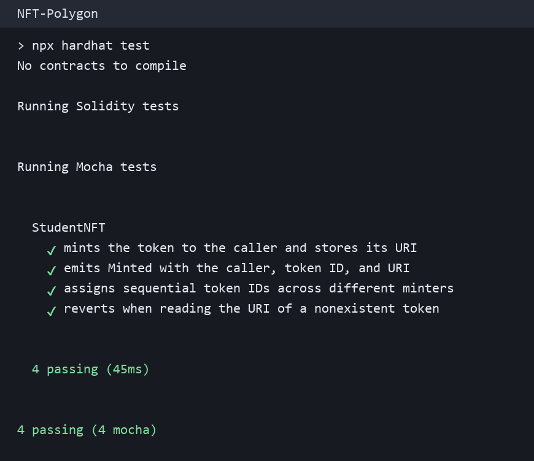

# NFT-Polygon

Учебный проект ERC-721 на Polygon PoS. Контракт `StudentNFT` выдаёт токен тому, кто вызвал `mint`, присваивает ID по порядку с `0`, сохраняет `tokenURI` и публикует событие `Minted`. Метаданные и картинка хранятся в IPFS через Pinata.

Стек проекта — Solidity, OpenZeppelin 5, TypeScript, Hardhat 3, Ignition и ethers.js 6. Тесты написаны на Mocha и Chai.

Текущая версия контракта берёт ровно `0,01 POL` за минт в Polygon и выпускает до `100` NFT. `withdraw()` переводит баланс владельцу контракта. Владелец может передать право управления, а отказ от владения заблокирован, чтобы сохранить возможность вывода средств.

## Результат в Polygon mainnet

В таблице указан исходный деплой с бесплатным минтом. Платная версия требует отдельного деплоя.

| Параметр | Значение |
| --- | --- |
| Сеть | Polygon PoS, chain ID `137` |
| Коллекция | Student NFT (`SNFT`) |
| Контракт | [`0x04AA635Bb7F1f4884dE36bC421491d3F203F917D`](https://polygonscan.com/address/0x04AA635Bb7F1f4884dE36bC421491d3F203F917D) |
| `tokenId` | `0` |
| Транзакция минта | [`0x84e5cf38180dbea582b795691564a6c848e8b8176f2f5c29af82341e8f393bc0`](https://polygonscan.com/tx/0x84e5cf38180dbea582b795691564a6c848e8b8176f2f5c29af82341e8f393bc0) |
| `tokenURI` | `ipfs://bafkreidsjeme74tfiglvwvhn3xavk6iks5utfzkurmdtkfamphjh7anzfa` |
| IPFS | [JSON-метаданные](https://copper-keen-carp-437.mypinata.cloud/ipfs/bafkreidsjeme74tfiglvwvhn3xavk6iks5utfzkurmdtkfamphjh7anzfa) · [Картинка](https://copper-keen-carp-437.mypinata.cloud/ipfs/bafybeifufnnd27gandfcfgkpwfn7dqnf7jggijovoq2gsj7no55saqkrje) |

## Структура проекта

| Файл | Назначение |
| --- | --- |
| [`contracts/StudentNFT.sol`](contracts/StudentNFT.sol) | ERC-721, платный минт с лимитом выпуска и вывод средств владельцем |
| [`test/StudentNFT.ts`](test/StudentNFT.ts) | Владелец, URI, событие `Minted`, ID, цена, лимит выпуска и права на вывод |
| [`scripts/upload-to-ipfs.ts`](scripts/upload-to-ipfs.ts) | Загрузка PNG и JSON в публичную сеть IPFS |
| [`ignition/modules/StudentNFT.ts`](ignition/modules/StudentNFT.ts) | Деплой коллекции с именем `Student NFT` и символом `SNFT` |
| [`scripts/mint-nft.ts`](scripts/mint-nft.ts) | Минт, чтение `tokenId` из события и проверка владельца и URI в контракте |
| [`hardhat.config.ts`](hardhat.config.ts) | Плагины, настройки Solidity и подключение к сетям |

## Установка и тесты

Нужны Git и Node.js 22.18+ или 24 LTS. Команды выполняются из корня проекта.

```powershell
npm ci
npx hardhat build
npx hardhat test
```



## Загрузка в IPFS

Для новой загрузки добавьте в локальный `.env` JWT от Pinata и домен своего шлюза.

```dotenv
PINATA_JWT=<ваш JWT>
PINATA_GATEWAYS=example.mypinata.cloud
```

```powershell
node --env-file=.env scripts/upload-to-ipfs.ts assets/my-nft.png
```

Скрипт загружает картинку, записывает её CID в поле `image` метаданных и загружает JSON. Значение после `tokenURI =` содержит CID JSON и передаётся в `mint`.

## Деплой и минт

Проверить модуль Ignition можно во временной сети Hardhat.

```powershell
npx hardhat ignition deploy ignition/modules/StudentNFT.ts --network hardhatMainnet
```

Для деплоя в Polygon сохраните RPC URL и приватный ключ учебного кошелька в зашифрованном keystore. Для платной версии используйте отдельный ID деплоя, чтобы сохранить историю исходной коллекции.

```powershell
npx hardhat keystore set POLYGON_RPC_URL
npx hardhat keystore set POLYGON_PRIVATE_KEY
npx hardhat ignition deploy ignition/modules/StudentNFT.ts --network polygon --deployment-id student-nft-paid-137
```

Адрес платной версии сохраняется в `ignition/deployments/student-nft-paid-137/deployed_addresses.json`. Для минта укажите адрес выбранного контракта и URI метаданных в локальном `.env`. Скрипт сам подставляет цену минта.

```dotenv
NFT_CONTRACT_ADDRESS=<адрес контракта>
NFT_TOKEN_URI=ipfs://bafkreidsjeme74tfiglvwvhn3xavk6iks5utfzkurmdtkfamphjh7anzfa
```

```powershell
npx hardhat run scripts/mint-nft.ts --network polygon
```

После подтверждения скрипт выводит `Token ID`, `Owner`, `tokenURI` и хеш транзакции. Деплой и каждый минт в Polygon mainnet расходуют POL на газ. `.env` исключён из Git.

## Контрольные вопросы

1. **Почему контракт хранит ссылку на метаданные?** Запись 1 МиБ заняла бы 32 768 слотов по 32 байта. Первичная запись в каждый холодный слот стоит примерно 22 100 газа. В сумме это **около 724 млн газа** только на запись данных. URI занимает несколько слотов и связывает токен с JSON и картинкой. [EIP-2200](https://eips.ethereum.org/EIPS/eip-2200) · [EIP-2929](https://eips.ethereum.org/EIPS/eip-2929)
2. **Что даёт `ipfs://<CID>` по сравнению с `https://myserver.com/1.json`?** CID привязан к содержимому. Если JSON поменяется, у новой версии будет другой CID. Тот же CID можно получить через другой IPFS-шлюз. Доступность зависит от узлов, у которых есть данные. Без пинов временные копии могут исчезнуть, и тогда файл не загрузится. [Хранение файлов в IPFS](https://docs.ipfs.tech/how-to/pin-files/)
3. **Что такое CID и почему у одной картинки могут быть разные CID?** CID — идентификатор, в который входит хеш блока и информация о его формате. Одинаковые байты дают одинаковый CID при одинаковых настройках импорта. Размер блоков, структура дерева, кодек или версия CID могут изменить итоговый идентификатор. [Документация IPFS о CID](https://docs.ipfs.tech/concepts/content-addressing/)
4. **Зачем `_safeMint`?** При минте на адрес контракта `_safeMint` проверяет ответ `onERC721Received`. Если получатель не поддерживает этот вызов или отклоняет токен, транзакция откатывается. `_mint` пропускает эту проверку. [ERC-721](https://eips.ethereum.org/EIPS/eip-721)
5. **Сколько газа ушло на деплой и минт?** Деплой использовал **1 198 504 газа**, минт токена `0` — **201 398 газа**. Деплой потребовал примерно в шесть раз больше газа, потому что исполняется конструктор и сохраняется байткод контракта. Минт вызывает функцию уже развёрнутого контракта, обновляет данные токена и пишет события. [Деплой](https://polygonscan.com/tx/0xfb8eccf4d4f382f3a0521e2bc09510803bb3c9bc32a3ad1a538b0bf1414518b0) · [Минт](https://polygonscan.com/tx/0x84e5cf38180dbea582b795691564a6c848e8b8176f2f5c29af82341e8f393bc0)
6. **Где хранится приватный ключ?** В зашифрованном keystore Hardhat под именем `POLYGON_PRIVATE_KEY`. В конфиге указано только это имя через `configVariable(...)`. Keystore защищён паролем, а значения в `.env` хранятся открытым текстом. [Зашифрованное хранилище Hardhat](https://hardhat.org/docs/guides/configuration-variables#using-the-keystore)
7. **Что делает Ignition при повторном деплое?** Ignition выполняет шаги модуля и сохраняет журнал, адреса и результаты транзакций. При повторном запуске с тем же ID деплоя и сохранённым журналом он продолжает с незавершённых шагов. Выполненный деплой контракта повторно не отправляется. [Деплой через Ignition](https://hardhat.org/ignition/docs/guides/deploy)
